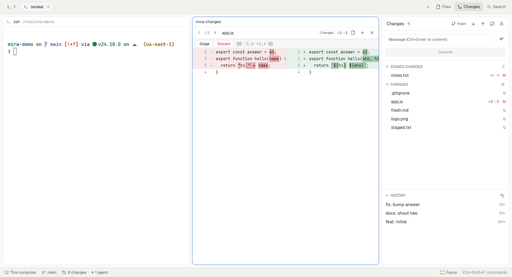

# mira layout for Herdr

A [Herdr](https://herdr.dev) layout that brings the review side of [mira](https://github.com/IGUNUBLUE/mira) into Herdr's own window: source control with staged and unstaged sections, side-by-side diffs with per-hunk actions, commit messages written with your ChatGPT plan, an editor with autosave, project search and replace, an image viewer, and a status bar with a focus mode.



**This layout is for the Herdr desktop app (`herdr-app`), not for `herdr-tui`.** It is written and tested against the app's window only.

It is a set of Herdr mods plus one layout file. Nothing in Herdr is modified: the layout starts as a copy of Herdr's `main` and points its panels at the `mira-*` mods.

## What you get

**Changes** (`mira-changes`, the panel on the right)

- Merge conflicts, Staged changes and Changes as separate sections. Stage, unstage, discard or open a file from its row; the section headers do it for every file and **Review** opens the first diff.
- **Commit** commits what is staged. With nothing staged the button becomes **Commit all (N)**; if that commit is rejected (a hook, say), what it staged is unstaged again. Conflicts block the commit. `Ctrl+Enter` commits from the message box.
- **Discard is undoable.** Before discarding, the working tree is snapshotted into `refs/herdr/snapshots/*` through a temporary index (your index is not touched). A bar then offers **Undo**. Confirmations list the files and warn that new files are deleted.
- **✦ writes the commit message**: Conventional Commits from the staged diff (or all changes when nothing is staged), with your ChatGPT plan through [Sign in with ChatGPT](https://developers.openai.com/siwc/token-sharing-open-source). Lockfiles and files with over 2,000 changed lines are left out of the diff (still listed), and the diff is capped at 12k characters. Click ✦ again while it works to stop and get back what you had.
- **Pull** (fast-forward only), **Push**, and **Publish branch** when the branch has no upstream (you pick the remote). Network git never prompts for passwords; OpenSSH gets `BatchMode` and an 8-second connect timeout unless you configured your own SSH command. Failures show git's message with **Copy details**, **Copy command** and **Retry via IPv4**.
- **Branch switcher**: click the branch. Local and cached remote branches, searchable, Up/Down and Enter. A remote branch gets a local tracking branch and never replaces an existing local one. It never fetches.
- **History** below the list, resizable: click a commit for its author, date, message and files; click a file for its diff against the first parent. Right-click a commit to copy its hash, short hash or subject. **Undo Last Commit** (`git reset --soft HEAD~1`) puts the message back in an empty box and keeps the changes staged; it refuses a detached HEAD, the first commit, a merge, an operation in progress, or a commit already on a remote branch.

**Diffs** (`mira-changes` as a pane beside the terminal)

- Two columns with the changed words highlighted. `‹ ›` walk the files of the section (or of the commit).
- Every hunk has **Stage** and **Discard** (unstaged diff) or **Unstage** (staged diff). Discarding a hunk is undoable too.

**Files** (`mira-files`)

- The tree with git colors, ignored files dimmed and file-type icons (from a Nerd Font when one is installed).
- **Right-click** a file or folder for **Open** (or Expand/Collapse), **Copy path**, **Copy relative path** and **Delete**. Delete asks first, removes a folder with everything inside and can't be undone by the layout; a deleted git-tracked file shows up in Changes.
- A click opens the file beside the terminal in an **editor** with syntax highlighting and **autosave** (1 s after you stop typing, and when the pane closes). It never overwrites a file that changed on disk under your edits: autosave pauses and offers **Reload from disk** or **Overwrite**. Files without unsaved edits follow changes on disk by themselves.
- **Images** (PNG, JPEG, GIF, WebP, BMP, ICO) open in a viewer: scroll to zoom, drag to pan, **Fit** and **100%**. SVGs open as text with a **Preview**.

**Search** (`mira-search`): ripgrep across the repository, respecting `.gitignore`, with match case, whole word and regex. Results open the file. **Replace all** asks first and rewrites line by line exactly as the results show, never over a file that changed meanwhile.

**Status bar** (`mira-status`): machine, branch (click to switch), ahead/behind, changed files (click for Changes), agents and "N need you" (click to go to the one waiting). **Focus** (`Ctrl+Shift+M`) hides the sidebar, the tab bar and the panel; press it again to bring back what was shown.

## Install

Requirements: the Herdr desktop app, which provides these commands (all must be on your `PATH`):

| Command | What it is | Used here for |
|---|---|---|
| `herdr-app` | The desktop app (the window). | Loads the layout and mods; `herdr-app do`, `check`, `status` drive and test them. Config lives in `~/.config/herdr-app`. |
| `herdr-core` / `hc` | The background runtime that keeps terminals alive (`hc` is its short name). | Runs the terminals and agents shown in the window. Nothing to configure for this layout. |

`herdr-tui` is a different front end and this layout isn't made for it. Also needed: `git`, `node` 24 (for the ChatGPT sign-in helper), `rg` for Search, `rsync` for the installer.

```sh
git clone https://github.com/IGUNUBLUE/mira-layout ~/Projects/mira-layout
cd ~/Projects/mira-layout
./install.sh            # copies layouts/mira.json and mods/mira-* into ~/.config/herdr-app
./install.sh --keys     # optional: also adds the shortcuts below to your keys.json
herdr-app do layout.switch '{"name":"mira"}'
```

`Ctrl+Shift+L` switches back to your previous layout. `./install.sh --uninstall` removes what it installed. The installer refuses to overwrite a mod or layout of the same name that it didn't install. Herdr does not hot-reload mods through symlinks, so files are copied; `./install.sh --watch` keeps copying while you edit the repository.

`--keys` only adds keys you don't use yet and prints the ones it skipped. Note that Herdr treats an edited `keys.json` as yours: new default shortcuts from future Herdr releases are no longer added to it automatically.

| Keys | What | Where |
|---|---|---|
| `Ctrl+Alt+F` | Open Search | `layout:mira` |
| `Ctrl+Shift+G` | Open Changes | `layout:mira` |
| `Ctrl+Shift+M` | Focus mode | `layout:mira` |
| `Ctrl+S` | Save the file | `mod:mira-files` |
| `Ctrl+Enter` | Commit | the message box |

More commands for your own bindings: `mira-changes.commit`, `.generate`, `.stage-all`, `.unstage-all`, `.discard-all`, `.undo-discard`, `.push`, `.pull`, `.branches`, `.undo-commit`, `.refresh`, `.focus`; `mira-tabs.files|changes|search`.

## Commit messages with your ChatGPT plan

The first time you click ✦ (or the account button next to Push), **Continue with ChatGPT** opens a terminal that runs the sign-in helper and your browser. You approve a client named "Herdr Commit"; ChatGPT then lets it use your plan for Responses API requests. This is OpenAI's documented flow for open-source, locally hosted apps ([overview](https://developers.openai.com/siwc/token-sharing-open-source), [sign-in](https://developers.openai.com/siwc/token-sharing-open-source/sign-in), [inference](https://developers.openai.com/siwc/token-sharing-open-source/models-and-inference)):

- OAuth with PKCE against `auth.openai.com`, a loopback callback on `127.0.0.1`, a dynamically registered client and a stable host id of its own. The ID token is verified against OpenAI's published keys and the plan scopes are checked.
- Requests go to `POST https://api.openai.com/v1/responses` with `store: false` and `stream: true`; only a `response.completed` counts. Usage-limit errors are reported as such.
- Credentials live in `~/.config/mira-layout/` (directory `0700`, files `0600`, written atomically) and are refreshed when less than a minute is left. They never go into Herdr's files.

The account menu picks the model from your plan's catalog and signs out. From a shell: `node ~/.config/herdr-app/mods/mira-changes/siwc.mjs login|status|models|model <slug>|logout`.

ChatGPT plan usage for apps is in preview at OpenAI and depends on your plan and workspace settings.

**What is sent:** only when you click ✦, the staged diff (or all changes) of that repository without lockfiles and very large files, its `--stat`, and the subjects of the last 8 commits. Nothing else in this layout uses the network, except git push/pull/fetch you start.

## Limits

- Herdr's `fetch` returns a response whole, so the commit message appears when it's done rather than streaming in.
- The editor has no bracket colors, bracket matching or guides, and Search opens a file without jumping to the line: Herdr's editor exposes neither the cursor nor decorations.
- Files on another machine (a remote space) open read-only in the editor, and Replace all works on this computer only: Herdr writes files locally only.
- Diffs show at most 4,000 rows, and long lines are cut at the column's width; open the file to read them whole.
- The commit-message sign-in can't be tested without a browser: try it once after installing.

## Development

```sh
npm test                 # node --test tests/*.test.js — pure modules, the SIWC helper, git snippets against temp repos
./install.sh --watch     # copy changes into Herdr as you save
herdr-app check ~/.config/herdr-app/mods/mira-changes
```

Each mod keeps its git parsing, diff pairing, prompt building, stream parsing, search and autosave rules in plain modules with no Herdr imports, so they run under Node. `RECIPE.md` is the brief to rebuild the layout from scratch, following Herdr's sharing format.
