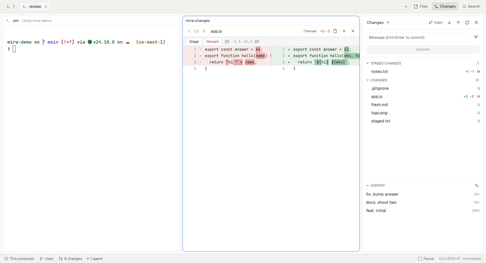

# mira

Herdr's own window, with mira's review tools around the terminal. On the right, a Changes panel with staged and unstaged sections, a commit box whose ✦ writes Conventional Commits with the person's ChatGPT plan, push/pull and history. Clicking a file opens a side-by-side diff pane beside the terminal, with Stage/Discard on every hunk. Files opens an editor with autosave and an image viewer, Search finds and replaces across the repository, and the status bar shows branch, changes and who needs you, with a focus mode.

## What you see

Left to right, as Herdr (main):

- **Sidebar**, 268px, `chrome`: Herdr's `workspace-chrome`, `spaces` and `agents`, unchanged.
- **Work column**:
  - **Tab bar**, 42px (`mira-tabs`): Herdr's tab pills, then `+`, then three panel buttons **Files**, **Changes** and **Search** (14px icon + 12px label; the shown one on `selected`).
  - **Body**, 8px padding: the active tab's panes as cards (radius 10, 1px `border`, `accent` when focused, Herdr's `pane` header 30px), and the **panel**, a 368px column (min 280, max 900, hidden until a panel button opens it) holding a stack `panel-body` of `files`, `changes` and `search`.
  - **Status bar**, 28px, `chrome` (`mira-status`): machine, branch, `↓behind ↑ahead`, "N changes", "N agents" (dot `working` while one works), "N need you" in `blocked`; on the right "Focus" and the palette hint. 11.8px, `muted`; items hover to `hover`.

**Changes panel** (rounded 10, 1px `border`, `background`):

- Header 42px: "Changes", a count badge, the branch (13px branch icon, clickable), `↓n`/`↑n`, icon buttons Pull, Push (an upload-cloud icon when the branch has no upstream), Refresh, account (person icon).
- Commit box: a 1–8 row textarea ("Message (Ctrl+Enter to commit)"), border `accent` while typing; ✦ (sparkles, `accent`) beside it; a full-width solid button "Commit", "Commit all (N)" with nothing staged, "Committing…" while it runs.
- Notes (errors in `ansi1`, info in `muted`) on a `raised` card with ×; git failures add "Copy details", "Copy command", "Retry via IPv4". A sign-in note has a solid "Continue with ChatGPT".
- Sections MERGE CONFLICTS (title in `ansi1`), STAGED CHANGES, CHANGES: 26px headers in 11px semibold caps with a chevron and a count pill; hovering shows Review (⇄), Discard all, Stage all / Unstage all. Rows (26px): name, its folder in 11px `dim`, `+n` `ansi2` / `−n` `ansi1`, status letter (A `ansi2`, D/U `ansi1`, R `ansi4`, M `blocked`; untracked shows U). Hovering a row swaps the counts for Open file, Discard, Stage/Unstage.
- A 5px drag divider, then HISTORY (default 220px, 80–900, remembered): commit subject and age (`2m`, `3d`), Undo Last Commit (↶) in the header. Expanded commits show "author · date · short hash", the body and their files.
- Confirmations draw over the panel: scrim `background` at 80%, a `popover` card 340px max with title, detail, the affected files in a `raised` list, Cancel (selected first) and the action (`ansi1` background for destructive ones).

**Diff pane**: a 36px header with ‹ n/m ›, the file name (semibold) and folder, a mode badge (Changes, Staged, New file, Commit abc1234), `+n −n`, Open file, Stage/Unstage file, ×. Hunk bars 30px on `raised`: Stage and Discard (red text) or Unstage, then the `@@` header in `dim`. Lines 20px in the terminal font at 12px; each column is half the pane: number (44px, `dim`), `-`/`+` sign, text. Removed lines `ansi1` at 11% alpha with changed words at 33%; added lines likewise in `ansi2`; empty sides `raised` at 40%.

**Editor pane**: 36px header with name, folder, "Saved / Edited / Saving… / Changed on disk / Read-only (remote)", ×; Herdr's code editor below. A conflict bar (`raised`, `ansi1` text) with "Reload from disk" and "Overwrite". Images: `raised` canvas, the image centered, header "W×H · zoom%", Fit, 100%. SVGs get a Preview/Text toggle.

**Search panel**: header "Search" and the repository name; a search field with toggles Aa, ab, .* (on: `selected` with `accent` border); a replace field and "Replace all"; a summary line ("12 results in 3 files", errors in `ansi1`); results grouped by file (chevron, name, folder, count) with 24px match rows (line number, the line with matches on `accent` at 20%).

**Branch switcher** (popup 380px): a search field with `accent` border, rows with branch icon, name, "current" in `accent`, "remote" / "other worktree" in `dim`; a hint line at the bottom.

## How it behaves

- Everything follows the focused terminal's folder (its repository). While a mod pane (diff, editor) has the keyboard, the previous terminal's folder stays, so panels don't jump.
- Panels refresh on a folder watch, every 10 s, and immediately when any mira mod changes git (shared `mira-changes.tick`).
- Agent statuses: the tab pills keep Herdr's spinner (working) and dot (blocked/done); the status bar counts agents, its dot is `working` while any works, and "N need you" (blocked) jumps with `agent.focus` to one not already focused.
- Clicking a changed file closes any diff pane in the tab and splits a new one to the right of the focused terminal. Files and Search results split an editor pane to the right.
- ✦: runs `siwc.mjs token`; exit 3/4 shows the sign-in note. Builds the request (staged diff, else `HEAD` diff plus the untracked file list; pathspec drops lockfiles and >2,000-line files; 12k cap; 8 recent subjects), posts it, keeps only a completed stream. While it works ✦ spins; clicking it again restores the previous text. Typing meanwhile discards the result.
- Discard and hunk Discard snapshot first, then offer Undo (with a confirmation, since later edits are replaced).
- Editor: autosave 1 s after the last change and on close; a disk change with no unsaved edits reloads; with unsaved edits it becomes a conflict and autosave stops. Checked on a folder watch and every 4 s.
- Focus mode remembers which of `sidebar`, `tabs`, `panel` were shown (shared `mira-status.focus`) and brings exactly those back.

## Built from

- `layouts/mira.json`: Herdr's `main` tree with `tabs` → `mira-tabs`, `files` → `mira-files`, `changes` → `mira-changes`, a third stack child `search` → `mira-search`, `status` → `mira-status`. `preview`: `layouts/mira.svg`.
- `mira-tabs`: a copy of Herdr's `tabs` with a Search button and `nextCommand` for `files|changes|search` (`layout.select` + `layout.show`, then `setShared("mira-<panel>.focus")`).
- `mira-changes`: `main.js` picks `Panel` (no props) or `DiffPane` (`props().diff = { root, on, path, orig, untracked, mode: unstaged|staged|commit, commit, parent, list }`). Pure modules: `git.js` (porcelain v1/v2 parsers, numstat, log, name-status, refs, snapshot script, discard/restore args, undo-commit rules), `hunk.js` (one hunk's patch, `git apply [--cached] [-R] --recount`), `sbs.js` (pairing and word LCS), `prompt.js`, `sse.js`. `siwc.mjs` is a Node helper (login, token, status, models, model, logout).
- `mira-files` right-click menu on a row (inline popover under it, closes on an outside press): Open/Expand/Collapse, Copy path, Copy relative path, Delete (`ansi1`). Delete opens the same confirm card as Changes ("Delete file?" / "Delete folder?", the path, Cancel selected first, Delete in `ansi1`), then runs `rm -rf -- "$1"` through `exec` (PowerShell `Remove-Item` on Windows), drops the row, refreshes and posts `mira-changes.tick`. Paths with `..` or a leading slash are refused.
- `mira-files`: `Tree` (Herdr's Files, plus `git ls-files --others --ignored --exclude-standard --directory` for dimming and Nerd Font icons from `fonts()`) or `EditorPane` (`props().file`). `logic.js`: icon table, image header sizes, `onDisk`, `mayAutosave`, `zoomStep`.
- `mira-search`: `rg --json` (`--fixed-strings` unless regex, `--ignore-case` unless match case, `--word-regexp`, `--hidden --glob !.git`), `search.js` for parsing, UTF-8 offsets and line-by-line replacement.
- `mira-status`, `mira-branches` (popup with `{ root, on }`).
- Herdr functions: `exec`, `readTextFile`, `writeTextFile`, `watchFolder`, `fetch`, `run` (`pane.split`, `pane.close`, `layout.*`, `agent.focus`), `openOverlay`, `shared`/`setShared`, `nextCommand`, `panes`, `focused`, `spaces`, `agents`, `fonts`, `appHome`, `fs/promises`.
- Programs: `git`, `node`, `rg`, `cp`, `stat`, `base64`, `file`, `mkdir`, `rm`, `sh`. Network: `auth.openai.com` (sign-in, JWKS) and `api.openai.com/v1` (models, responses) only when the person signs in or clicks ✦.

## Watch out

- A mod can't import from another mod's folder, and `init(props)` doesn't carry a pane's props: read `props()`.
- `image()` only loads from inside Herdr's home: copy images to a hidden `.cache/` folder there (hidden folders don't reload mods) and use a new name per version.
- No `TextEncoder`/`TextDecoder`: convert ripgrep's UTF-8 byte offsets by hand.
- Popups size to their content: a `flex_1` list inside one collapses to 0; give it a height.
- Virtual lists can't hold handlers; hunk bars have buttons, so diff rows are plain children (capped).
- Nested horizontal scrolling with per-cell min widths made columns uneven; half-width cells with cut lines are reliable.
- Snapshot commits need an identity even in repos without `user.email`: set `GIT_AUTHOR_*`/`GIT_COMMITTER_*` in the script.
- Herdr's `fetch` is not streaming; parse the whole SSE body. Mods can't listen on a port, so the OAuth callback lives in the Node helper started in a terminal pane.
- `<mod>.<command>` reaches only shown copies: route panel keys through `mira-tabs` (always shown).

## Done when

- `herdr-app check` passes for all six mods and `npm test` passes.
- `layout.switch {name: "mira"}` shows Herdr's window with Files / Changes / Search buttons and the mira status bar.
- In a repo with a staged file, a modified file and a new file: Changes lists them in Staged and Changes; Stage all / Unstage all move them; Commit commits only the staged one; Commit all (N) appears with nothing staged.
- Discard all empties Changes (new files deleted) and Undo brings every file back.
- A modified file's diff pane shows two columns with changed words highlighted; Stage on one of two hunks stages only that hunk.
- With no ChatGPT session, ✦ shows "Continue with ChatGPT"; after signing in, ✦ fills the box with a Conventional Commit.
- Push on a branch without upstream asks for the remote and publishes it; Pull reports "Pulled."; Undo Last Commit restores the message and keeps the changes staged.
- Files dims `node_modules/`; a file opens in an editor that reloads when the file changes on disk; a PNG opens in the viewer and zooms with the wheel.
- Search finds a word in tracked files only, and Replace all rewrites them after confirming.
- `Ctrl+Shift+M` leaves only the terminals and the status bar; pressing it again restores them.
